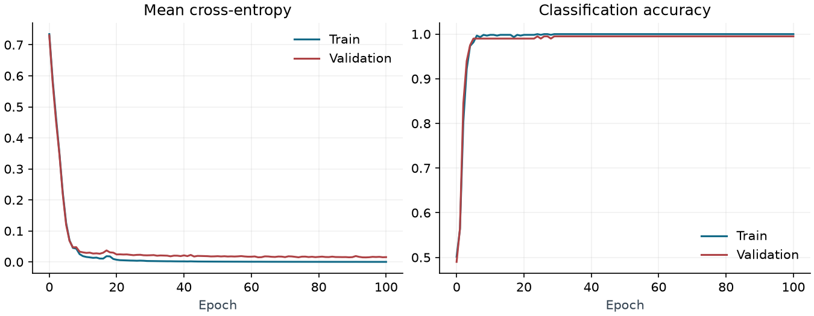

# NeuralForge — Neural Networks From Scratch

Can a network learn which arm of a spiral a point belongs to using only its two coordinates? This NumPy multilayer perceptron learned a curved boundary that classified **200 of 200 held-out points** on a fixed, noisy two-spiral split. Every weight update comes from an explicitly computed gradient.


Markers show the true labels of test points. The black contour marks equal class probability. Deeper shading means the model assigns more probability to one arm.

## Inside the model

| Stage | Shape for a batch of B | Operation |
| --- | --- | --- |
| Input | B × 2 | Coordinates standardized with training-set statistics |
| Hidden 1 | B × 32 | Dense projection and tanh |
| Hidden 2 | B × 32 | Dense projection and tanh |
| Output | B × 2 | Logits, then mean softmax cross-entropy |

The default model has 1,218 trainable parameters. Each dense layer computes $Z=AW+b$. The output gradient is the predicted class distribution minus the target one-hot distribution, divided by batch size. During the backward pass each layer computes $A^T D$ for its weights and propagates $DW^T$ through the preceding activation. A worked example follows one point from matrix multiplication through its first SGD update. [Mathematics walkthrough](docs/mathematics.md)

- **Implementation.** The network accepts arbitrary layer widths and either tanh or ReLU. It caches layer inputs, computes all gradients, then updates parameters. Cross-entropy subtracts the maximum logit in each row before exponentiation. [Network](neuralforge/network.py) · [Optimizers](neuralforge/training.py)
- **Data.** The generator samples 500 points per arm with angular and positional noise. A stratified split yields 600 training, 200 validation and 200 test points. Separate seeds control data (41), weights (17) and batch order (7). [Generator](neuralforge/data.py)
- **Training.** Adam runs for 100 epochs at learning rate 0.01 in batches of 64, including each epoch’s final partial batch. Every setting uses the same epoch budget. The reported checkpoint is the final epoch. [Experiment runner](experiment.py)

## Measured results

| Split | Correct | Accuracy | Mean cross-entropy |
| --- | ---: | ---: | ---: |
| Test before training | 112 / 200 | 56.0% | 0.677069 |
| Training at epoch 100 | 600 / 600 | 100.0% | 0.000259 |
| Validation at epoch 100 | 199 / 200 | 99.5% | 0.015535 |
| Test at epoch 100 | 200 / 200 | 100.0% | 0.000374 |

Validation accuracy first reached 95% at epoch 4. Accuracy flattened early while cross-entropy continued to fall as the network assigned higher probabilities to correct predictions. [Epoch history](results/history.json)



## Independent checks

Centered finite differences checked all 35 parameters of a smaller tanh network. The relative L2 gradient error was **1.40 × 10⁻¹⁰**, with a maximum absolute discrepancy of **9.79 × 10⁻¹²**. [Gradient checker](neuralforge/check.py)

A PyTorch CPU model copied the NumPy weights (transposed for PyTorch's linear layers) and biases. Both used float64, identical batch indices and Adam with the same learning rate, moment decays and epsilon. After 1,000 updates, the largest difference across all 400 test logits was **8.88 × 10⁻¹⁵**. PyTorch also classified 200/200 correctly with mean loss 0.000374. [Reference implementation](neuralforge/reference.py)

On Windows with Python 3.13.1, the NumPy fit took **0.157 s** including epoch metrics. The full experiment took **5.45 s** from data generation through plotting, excluding interpreter startup and initial imports. All **9 local tests passed in 3.10 s**, including checks for extreme logits, both activation derivatives, deterministic training and optimizer agreement. Runtime varies by machine. [Test suite](tests/)

## Controlled experiments

Each row changes one setting from the first row. Width applies to both hidden layers. Data, initialization seed, batch permutations and activation stay fixed. Different widths necessarily have different weight matrices.

| Optimizer | Width | Learning rate | Final validation accuracy | Final validation loss |
| --- | ---: | ---: | ---: | ---: |
| Adam | 32 | 0.010 | 99.5% | 0.01554 |
| Adam | 32 | 0.001 | 99.0% | 0.02585 |
| Adam | 32 | 0.030 | 99.5% | 0.02302 |
| Adam | 8 | 0.010 | 99.0% | 0.03869 |
| Adam | 64 | 0.010 | 99.5% | 0.02305 |
| SGD | 32 | 0.010 | 94.0% | 0.36315 |

Doubling width or tripling the Adam learning rate preserved validation accuracy but increased loss. Plain SGD made 11 more validation errors than Adam at the shared learning rate. Each validation error changes accuracy by half a percentage point on this split. The comparison measures a fixed update budget with a shared rate. Independently tuning SGD could change the ranking. [Machine-readable results](results/summary.json)

## Verify and reproduce on Windows

From the repository root, use Python 3.13 and PowerShell. These commands create an isolated environment and run the NumPy pipeline. The output directory keeps new runs separate from the published figures.

```powershell
py -3.13 -m venv .venv
.\.venv\Scripts\python -m pip install -r requirements-dev.txt
.\.venv\Scripts\python experiment.py --out runs\numpy
.\.venv\Scripts\python -m pytest -q
```

To include the matched CPU reference and both framework-parity tests, install the optional wheel and rerun. Omitting `--out` writes the figures and JSON into `results/`.

```powershell
.\.venv\Scripts\python -m pip install torch==2.15.0 --index-url https://download.pytorch.org/whl/cpu
.\.venv\Scripts\python experiment.py --reference --out runs\full
.\.venv\Scripts\python -m pytest -q
```

## Limits of the experiment

The test set samples a single synthetic distribution at the same noise level as training. A perfect score here covers 200 points and one seed. Regions far from either arm have little data support even when the decision plot shows high confidence. Multiple seeds, noise levels and spiral turn counts would be needed to estimate robustness.

## License

[MIT](LICENSE)
