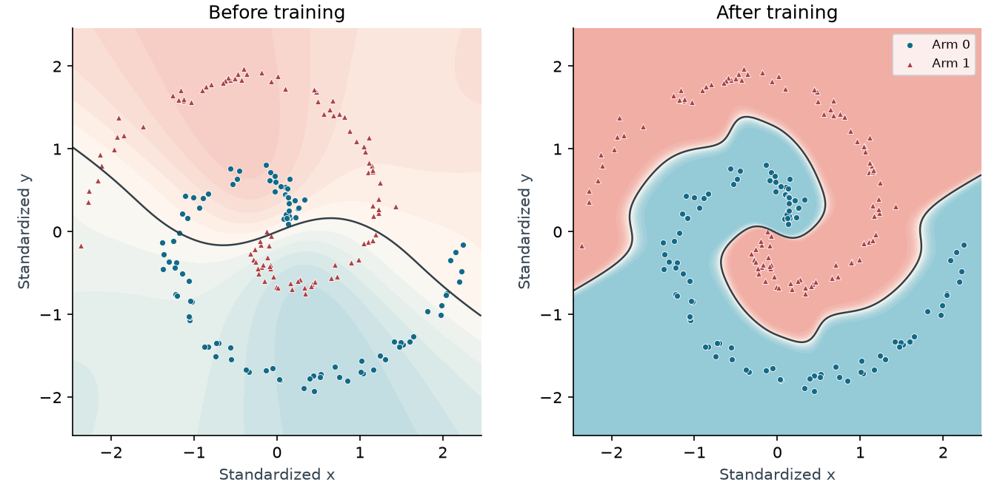

# NeuralForge

I wanted to understand how neural networks learn, so I built a small one from scratch using Python and NumPy. I used two interleaved spirals because I could draw the answer I wanted the network to learn. A straight line cuts through both arms. Can a network learn to follow the gap between them using just the two coordinates?



These are predictions from the original run. Circles and triangles show the true labels of the 200 test points. The black line is where the two output probabilities are equal.

## What the hidden layers buy

I trained two models on each split. The linear baseline uses a single affine layer and softmax, which gives it six trainable parameters and a straight decision boundary. The MLP maps the same coordinates through **2 → 32 → 32 → 2** units, with tanh in both hidden layers and 1,218 trainable parameters. Both use the same cross-entropy objective, Adam settings, batch order and 100-epoch budget.

| Model | Mean test accuracy | SD (percentage points) | Mean test loss | SD (loss) |
| --- | ---: | ---: | ---: | ---: |
| Linear softmax | 55.10% | 4.64 | 0.58056 | 0.03629 |
| Two hidden layers | 99.90% | 0.22 | 0.00241 | 0.00308 |

I kept the original run and added four consecutive seeds. Each run generates a fresh dataset and changes the weight-initialization and batch-order seeds. I calculated the sample standard deviation across the five run-level values. The MLP made one error in total, on data seed 43. Even on the four runs with perfect accuracy, loss varied because the model assigned different probabilities to the correct labels. [All seed triples and unrounded scores](results/summary.json)

## How the training code works

I keep one example per row. A dense layer computes $Z=AW+b$, so each column of $W$ learns one unit’s weights. Tanh or ReLU transforms the hidden units. The last layer gives one raw score per class. In the loss function I subtract the largest score in each row before taking exponentials, which keeps softmax numerically stable.

The backward pass starts with $D=(P-Y)/B$, where $P$ contains class probabilities, $Y$ is the one-hot target and $B$ is the number of examples in the current batch. The cached layer input gives the weight gradient $A^T D$. Multiplying $D$ by the transposed weights carries the derivative back to the previous activation. The optimizer updates the weights after all layers have contributed their gradients. [NumPy implementation](neuralforge/network.py) · [One update worked by hand](docs/math.md)

### Where each split is used

I generate 500 noisy points per arm, then split each arm into 300 training, 100 validation and 100 test points. The training rows supply the coordinate means and standard deviations used to scale all three splits. Only training rows enter mini-batches. I use validation loss and accuracy to compare settings and always score the epoch-100 weights. There is no early stopping. The test set supplies final comparisons, the pretraining score and the points in the boundary plot. [Data generator](neuralforge/data.py) · [Training loop](neuralforge/training.py)

## A closer look at the original run

With seeds 41 for data, 17 for weights and 7 for shuffling, the untrained network classified **112/200** test points correctly (loss **0.677069**). After training it classified **200/200** (loss **0.000374**). It first reached 95% validation accuracy at epoch 4 and finished at 199/200 with loss 0.015535. Training finished at 600/600 with loss 0.000259.


I changed one setting at a time on this split. Width is the number of units in **each** hidden layer. Every run used batches of 64, including the last partial batch of each epoch.

| Optimizer | Width | Learning rate | Final validation accuracy | Final validation loss |
| --- | ---: | ---: | ---: | ---: |
| Adam | 32 | 0.010 | 99.5% | 0.01554 |
| Adam | 32 | 0.001 | 99.0% | 0.02585 |
| Adam | 32 | 0.030 | 99.5% | 0.02302 |
| Adam | 8 | 0.010 | 99.0% | 0.03869 |
| Adam | 64 | 0.010 | 99.5% | 0.02305 |
| SGD | 32 | 0.010 | 94.0% | 0.36315 |

Doubling the width bought no extra correct validation predictions and increased loss. An eight-unit network came within one prediction of the 32-unit model. SGD made 11 more errors than Adam at the shared learning rate. I’d need to tune SGD separately to compare each optimizer at its best. [Epoch-by-epoch history](results/history.json)

## How I checked the implementation

**Gradients.** On a small tanh network I perturbed all 35 parameters individually. The analytical and finite-difference gradients had relative L2 error **1.40 × 10⁻¹⁰** and maximum absolute difference **9.79 × 10⁻¹²**. The tests also exercise ReLU away from its kink and cross-entropy on extreme logits. [Gradient checker](neuralforge/check.py) · [Tests](tests/)

**PyTorch parity.** I copied the initial weights and biases into matching float64 CPU layers, transposing each weight matrix for PyTorch. Both implementations used the same inputs, tanh layers, mean cross-entropy and shuffled index batches. Adam used a learning rate of 0.01, betas of 0.9 and 0.999, epsilon of 10⁻⁸ and zero weight decay. Both took 1,000 steps. The largest initial training-logit difference was **6.66 × 10⁻¹⁶**. The largest final test-logit difference was **8.88 × 10⁻¹⁵**. I use that agreement to check the implementation. The five separately seeded NumPy runs above measure training performance across runs. [PyTorch reference](neuralforge/reference.py)

## Run it on Windows

From the repository root in PowerShell, create a Python 3.13 environment. The CPU-only commands below regenerate the figures and JSON in `results/` and run the full test suite.

```powershell
py -3.13 -m venv .venv
.\.venv\Scripts\python -m pip install -r requirements-dev.txt
.\.venv\Scripts\python -m pip install torch==2.15.0 --index-url https://download.pytorch.org/whl/cpu
.\.venv\Scripts\python experiment.py --reference
.\.venv\Scripts\python -m pytest -q
```

For the NumPy experiments alone, skip the PyTorch install and run `experiment.py --out runs/numpy` with the same interpreter. The reference tests skip when PyTorch is absent. [Experiment runner](experiment.py) · [MIT license](LICENSE)

I repeated the full run in a fresh Python 3.13.1 environment on Windows. The metrics reproduced, and both figures and the epoch history matched byte for byte. The original NumPy fit took 0.178 s. The full experiment, including all five pairs, the validation sweep, PyTorch and plotting, took 5.47 s after initial imports. All 10 tests passed in 3.09 s.

## Limitations

These are synthetic spirals with a fixed number of turns and a fixed noise model. There are only 200 test points per run, so a single mistake moves accuracy by half a percentage point. Five runs give a rough sense of variability under this generator. They say little about heavier noise, new spiral shapes or real data. In particular, the confident colors far outside the two arms have few nearby observations to support them.

## Let's Connect

If you’re curious about what happens between a forward pass and a weight update, I’d be glad to walk through the math of backpropagation and gradient descent and show how those steps map to NumPy. I can explain why I built a small implementation, how I checked it against finite differences and PyTorch, and what the spiral experiments taught me about verification and its limits.

I’d enjoy hearing how you approach those checks. [Reach me on GitHub](https://github.com/sslcat).
